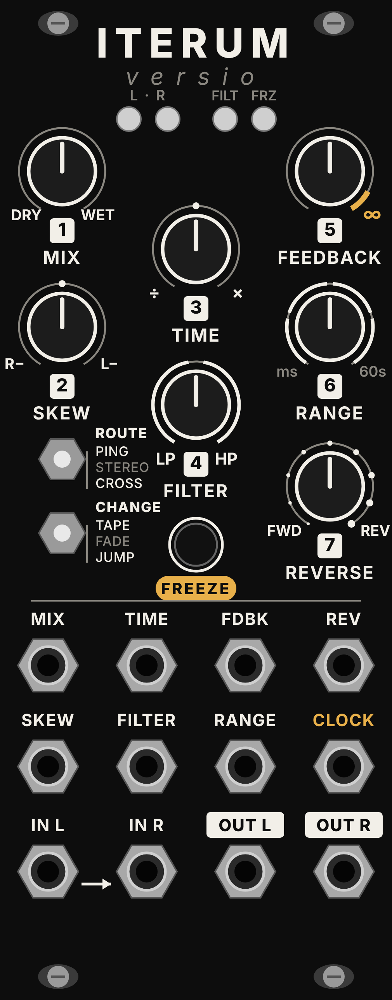

# Iterum Versio

*Iterum* — Latin for "again".

An alternative firmware for the **Noise Engineering Versio** Eurorack platform: a clockable stereo delay inspired by the Make Noise Mimeophon and the Qu-Bit Nautilus, with ping-pong, skew, probabilistic reverse, freeze and a DJ-style filter inside the feedback loop. Delay times reach **60 seconds** (about 43 s in reverse).

<p align="center">
  
</p>

> This is an independent, unofficial project. It is not affiliated with or endorsed by Noise Engineering, Electro-Smith, Make Noise or Qu-Bit Electronix. "Versio" is used only to identify the hardware this firmware runs on.

## Features

- Stereo delay up to 60 s forward, ~43 s reverse (two 87-second buffers in SDRAM)
- External clock on the FSU jack, with 20 delay/clock ratios from 1/16 to 16
- Four free-running time ranges: 5–100 ms · 50–600 ms · 0.3–3 s · 1.5–60 s
- Bipolar **skew** between left and right delay times
- Three routings: **ping-pong**, **stereo**, **cross**
- Three ways to change time: **tape** (repitch), **fade** (crossfade), **jump**
- **Probabilistic reverse**: each repeat chooses its direction at random
- **Freeze** on the FSU button: loops the buffer indefinitely, up to 60 s
- **DJ filter** (12 dB/oct low-pass / high-pass) in the feedback path
- Feedback up to 110 %, held by soft saturation; soft limiter on the outputs

## Controls

```
     [1 MIX]      [3 TIME]      [5 FEEDBACK]
     [2 SKEW]                   [6 RANGE]
                  [4 FILTER]
 ABC  ROUTE                     [7 REVERSE]
 XYZ  CHANGE        [FSU] FREEZE        FSU jack = CLOCK
```

Every knob has a matching CV input (jacks 1–7), summed with the knob.

| # | Control | Free-running | Clocked |
|---|---|---|---|
| 1 | **MIX** | dry/wet, equal power | |
| 2 | **SKEW** | bipolar: centre = equal times; left shortens the right channel, right shortens the left channel, down to ½ | 9 steps: ½, ⅔, ¾, ⅞ (right) · equal · ⅞, ¾, ⅔, ½ (left) |
| 3 | **TIME** | time within the selected range (exponential) | ratio to the clock: 1/16, 1/12, 1/8, 1/6, 1/4, 1/3, 3/8, 1/2, 2/3, 3/4, **1** (noon), 4/3, 3/2, 2, 3, 4, 6, 8, 12, 16 |
| 4 | **FILTER** | left = low-pass (20 kHz → 500 Hz), centre = off, right = high-pass (20 Hz → 1.2 kHz). It sits inside the feedback loop, so each repeat is filtered again | |
| 5 | **FEEDBACK** | 0–110 %. Above 100 % the repeats build up and are held by soft saturation | |
| 6 | **RANGE** | 4 zones: 5–100 ms · 50–600 ms · 0.3–3 s · 1.5–60 s | ignored |
| 7 | **REVERSE** | fully left = always forward, fully right = always reversed. In between, each repeat is reversed with a probability equal to the knob position | |

**ABC — ROUTE**
- **A · Ping-pong**: the input is summed to mono and enters on the left, then bounces L → R → L
- **B · Stereo**: two independent delay lines
- **C · Cross**: stereo input with cross-coupled feedback (ping-pong that keeps the stereo image)

**XYZ — CHANGE** (how time changes are handled)
- **X · Tape**: like a tape machine, changing the time repitches the repeats
- **Y · Fade**: 60 ms crossfade to the new time, no pitch change
- **Z · Jump**: near-instant (3 ms) switch, good for glitches and stutters

**FSU**
- **Jack**: external clock. The period is measured between two rising edges; the last tempo is kept if the clock stops
- **Button**: toggles **freeze**. The buffer is looped at the current delay length (up to 60 s); input and feedback are muted. TIME, CHANGE and REVERSE keep working on the frozen material, the filter only affects the output
- **Button held 1.5 s**: back to free-running time (the freeze state is left unchanged)

**In 1** is normalled to **In 2**: patch a single cable into In 1 for a mono source.

**LEDs** (left to right)
1. **Left repeats** — 2. **Right repeats**: each blinks when a repeat arrives on its side. White = forward (free-running), cyan = forward (clocked), violet = reversed. When clocked, blinks are locked to the incoming clock
3. **Filter**: orange = low-pass, light blue = high-pass, brighter as it closes; off at centre
4. **Status**: solid red = freeze, pulsing red = feedback above 100 %

## Installing

A prebuilt binary is in [`firmware/IterumVersio.bin`](firmware/IterumVersio.bin).

1. Connect the Versio to your computer via the USB port of the Daisy Seed on the back of the module.
2. Put the Seed in DFU mode: hold **BOOT**, press and release **RESET**, then release **BOOT**.
3. Flash it with the [Electro-Smith Web Programmer](https://flash.daisy.audio/) (Chrome/Edge), or with `make program-dfu` after building from source (see [BUILD.md](BUILD.md)).

Before flashing, make sure you have a copy of the original Noise Engineering firmware so you can go back at any time.

## Building from source

See [BUILD.md](BUILD.md) for the toolchain, the libraries, how to compile and flash, and how to adjust the knob and switch mapping.

## Panel

The [`panel/`](panel) folder contains the panel artwork:

- `iterum_versio_panel.svg` — preview with knobs, jacks and switches drawn in
- `iterum_versio_panel_print.svg` — artwork only, with hole positions as red guides
- `make_panel.py` — the Python script that generates both (no dependencies)

The SVG is drawn at real 10HP size (50.5 × 128.5 mm). **Hole positions were measured from a photo of a Versio panel: check them against a real panel before having one made.**

## Technical notes

- 48 kHz, 32-sample blocks, CPU at 480 MHz
- Buffers: 2 × 4,194,304 float samples in SDRAM (32 of 64 MB)
- Forward reads use 4-point Hermite interpolation. In Tape mode the time follows the knob with ~250 ms slew and the "tape speed" is limited between −3× and +5×
- Reverse: two overlapping grains with a sin² window, each as long as the delay; each grain plays the just-recorded segment backwards
- Feedback path: DJ filter (2-pole TPT state-variable filter, Butterworth response), DC blocker, soft saturation; soft limiter above 0.8 on the outputs
- LEDs use libDaisy's software PWM, updated 4000 times per second

## License

[MIT](LICENSE). libDaisy and DaisySP are © Electro-Smith and released under the MIT license.
